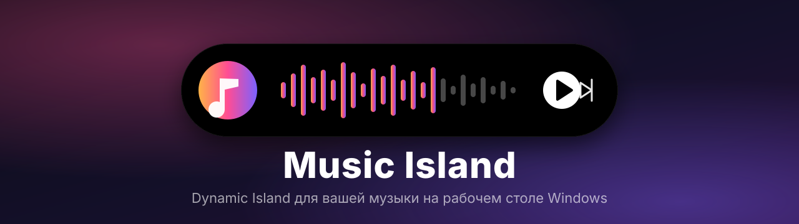

<div align="center">



<br>


**Music Island — an open-source Dynamic Island music player for Windows 10/11 with Spotify, YouTube, SoundCloud and Yandex Music.**

**[⬇ Download / Скачать](../../releases/latest)** &nbsp;·&nbsp; **[🌐 Website](https://luviel19.github.io/Music_Island/)** &nbsp;·&nbsp; **[✨ Возможности](#-возможности)** &nbsp;·&nbsp; **[🎵 Площадки](#-площадки)** &nbsp;·&nbsp; **[🛠 Сборка](#-сборка-из-исходников)** &nbsp;·&nbsp; **[❓ Вопросы](#-вопросы-и-ответы)**

<br>


<br><br>


<br><br>


</div>

<details>
<summary><b>🇬🇧 English</b></summary>

<br>

Music Island is a small always-on-top «island» for your Windows desktop. It shows the current track, a waveform progress bar and playback controls, expands on hover and adapts its colours to the cover art.

- **Sources:** Spotify (the official web player inside the island via Microsoft Edge WebView2, Free or Premium), YouTube, SoundCloud, Yandex Music and any system media player.
- **One search** across all sources, a 10-band equalizer (Yandex Music and SoundCloud), queue, likes, media keys, tray menu, autostart.
- **Spotify without developer keys:** you log in on the real open.spotify.com page; the island controls playback through Windows media controls and reads the queue from the page. No Spotify Web API, no Client ID, no cookie extraction, no ad blocking.
- **Stays on screen:** the island cannot be dragged off screen, collapsed it snaps into the very corner, and it survives Win+D.

**Download:** [latest release](../../releases/latest) · Windows 10/11 x64 · MIT license.
**Build:** `npm install && npm run build:spotify && npm start`

> Not affiliated with Spotify, YouTube, SoundCloud or Yandex. Spotify has no like, shuffle or equalizer in the island because the embedded web player does not expose them.

</details>

<br>

## 💡 Что это

**Music Island** — маленький «остров» в стиле Dynamic Island, который висит поверх рабочего стола. В свёрнутом виде он показывает живой индикатор, при наведении раскрывается: обложка, название, волна, кнопки. Цвета острова подстраиваются под обложку трека.

Все ваши музыкальные сервисы в одном месте, без лишних окон и вкладок.

<br>

## ✨ Возможности

<table>
<tr>
<td width="50%" valign="top">

### 🎛 Всё в одном окне
Яндекс Музыка, SoundCloud, YouTube, Spotify и системный плеер. Переключение через список прямо на острове или из трея.

### 🔎 Поиск по всем площадкам
Один запрос ищет сразу везде. Одна и та же песня склеивается в одну строку, а значки показывают, где она нашлась. Клик по значку запускает её именно там.

### 🌊 Волновой прогресс
Палочки повторяют форму песни, клик по волне перематывает.

### 🎚 Эквалайзер на 10 полос
Для Яндекс Музыки и SoundCloud: ручная настройка, пресеты и красивая сетка квадратиков на фоне острова в цвет обложки.

</td>
<td width="50%" valign="top">

### 🧭 Настройка «Моей волны»
Яндекс Музыка: подбор по настроению, занятию и характеру песен.

### 📜 Очередь и карточка трека
Листайте следующие треки, открывайте подробности, ставьте лайки.

### 🖱 Остров ваш
Перетаскивается куда угодно, положение можно закрепить. Работает поверх всех окон, раскрывается при наведении, не мешает кликам мимо себя.

### ⌨️ Медиа-клавиши и трей
Глобальные клавиши, меню в трее, автозапуск вместе с Windows.

### 🔔 Обновления
Когда на GitHub выходит новая версия, остров сам покажет уведомление с кнопкой «Скачать».

</td>
</tr>
</table>

<br>

## 🎵 Площадки

| | Что есть | Вход |
|---|---|---|
|  | «Моя волна» с настройкой, избранное, лайки, очередь, эквалайзер | OAuth-токен |
|  | Тренды, ваши лайки, трек по ссылке из буфера, эквалайзер. Поддерживает HLS-треки | Необязателен, нужен для лайков |
|  | Поиск, микс по ссылке на видео | Не нужен |
|  | Официальный веб-плеер внутри острова, очередь, разделы «Главная», «Моя музыка» и «Плейлисты», громкость | Ваш аккаунт Spotify (Free или Premium) |
|  | Всё, что играет в Windows: браузер, приложения и другие плееры | Не нужен |

<br>

### 🟢 Spotify подробнее

Spotify подключается **через официальный веб-плеер** `open.spotify.com` в Microsoft Edge WebView2. Остров не просит ключи разработчика и не требует Premium.

- Войдите на настоящей странице Spotify: пароль остаётся только у Spotify, сессия хранится на вашем ПК.
- Остров показывает название, обложку и прогресс, управляет воспроизведением, громкостью и очередью.
- Кнопка **«Моя музыка»** сама включает ваши «Любимые треки» без показа окна.
- Библиотека, плейлисты и поиск открываются в панели с официальной страницей Spotify (кнопка со стрелкой).
- Spotify Desktop и отдельное окно Edge не нужны, WebView2 Runtime уже есть в Windows 10 и 11.

> [!NOTE]
> Встроенный плеер не отдаёт данные из интерфейса, поэтому у Spotify в острове нет лайка, перемешивания, эквалайзера и собственного списка результатов поиска. Это ограничения самого способа, а не недоработки: подробности в разделе [«Ограничения»](#️-ограничения).

<br>

## 📥 Установка

1. Скачайте `Music-Island-Setup-*.exe` из раздела **[Releases](../../releases)**.
2. Запустите установщик, выберите папку и дождитесь окончания.
3. Остров появится на экране, а иконка в трее даст доступ к настройкам.

> [!NOTE]
> Установщик не подписан цифровой подписью, поэтому Windows SmartScreen может показать окно «Windows защитила ваш компьютер».
> Нажмите **«Подробнее» → «Выполнить в любом случае»**.

<br>

## 🔑 Вход и настройка

| Площадка | Как подключить |
|---|---|
| **Яндекс Музыка** | Остров сам подскажет, как получить токен, и покажет кнопку вставки. Токен хранится только на вашем ПК в зашифрованном виде |
| **SoundCloud** | Слушать можно без входа. Для лайков вставьте значение cookie `oauth_token` |
| **Spotify** | Выберите «Spotify», нажмите «Подключить аккаунт» и войдите на странице Spotify |
| **YouTube, системный плеер** | Вход не нужен |

### 🌍 VPN или прокси для SoundCloud и YouTube

Если сервис недоступен в вашей стране, откройте в трее **«VPN/прокси»** и вставьте ссылку из буфера обмена:

- ссылка на **подписку VPN**: остров сам перебирает серверы hysteria2 из подписки и берёт первый рабочий;
- ссылка `hysteria2://…`;
- адрес `socks5://host:port` или `http://host:port`.

Через VPN идут **только SoundCloud и YouTube** (вместе с их входом и капчами), все остальные площадки работают напрямую. Ссылка хранится зашифрованной, VPN включается и выключается одной галочкой в трее.

<br>

## 🛠 Сборка из исходников

Нужны Windows 10/11 и [Node.js](https://nodejs.org) 20+.

```bash
git clone https://github.com/luviel19/Music_Island.git
cd Music_Island
npm install
npm run build:spotify   # собирает веб-плеер Spotify (нужен только .NET Framework 4.8 из Windows)
npm start
```

Установщик:

```bash
npm run dist
```

Готовый `Music-Island-Setup-*.exe` появится в папке `dist/`.

Для режима VPN положите `hysteria.exe` в папку `bin/` (в репозиторий он не входит).

<br>

## 🧩 Архитектура

Каждая площадка подключается как **провайдер** из двух частей:

```
providers/<id>.js        основной процесс: сеть, токены, доступ к системе
src/providers/<id>.js    интерфейс: воспроизведение, очередь, управление
```

Контракт описан в `src/providers/registry.js`. Чтобы площадка участвовала в общем поиске, добавьте метод `search(host, запрос)`, а для запуска найденного трека `open(host, трек, список)`. Возможности площадки перечисляются в `caps`: выключенная функция просто не показывается в интерфейсе, и ничего не имитируется.

```
.
├── main.js                  окно, трей, настройки, VPN, перетаскивание
├── tunnel.js                запуск hysteria2 для VPN
├── updater.js               проверка новых релизов на GitHub
├── preload.js               мост между окном и основным процессом
├── providers/               провайдеры основного процесса (+ мост SMTC на PowerShell)
├── native/spotify-host/     веб-плеер Spotify на WebView2 (C#, .NET Framework 4.8)
├── src/                     интерфейс острова
│   ├── app.js               ядро: состояния, эквалайзеры, волна, меню
│   ├── search.js            поиск по площадкам и склейка результатов
│   ├── audio-fx.js          эквалайзер на Web Audio
│   └── providers/           провайдеры интерфейса
├── tests/                   проверки логики (npm test)
└── assets/                  иконки, баннер и скриншоты
```

<br>

## ❓ Вопросы и ответы

<details>
<summary><b>Нужен ли Spotify Premium?</b></summary>

Нет. Остров открывает обычный веб-плеер Spotify, поэтому работает Free (с рекламой, как в браузере) и Premium.
</details>

<details>
<summary><b>Почему у Spotify нет лайка и эквалайзера?</b></summary>

Звук играет сам Spotify внутри встроенной страницы, а состояние лайка и перемешивания она наружу не отдаёт. Остров не показывает функции, которые не может честно выполнить.
</details>

<details>
<summary><b>SoundCloud или YouTube не открываются</b></summary>

Включите VPN или прокси в трее (раздел «VPN или прокси»). Остальные площадки он не затрагивает.
</details>

<details>
<summary><b>Остров мешает кликам по окнам под ним</b></summary>

Нет: прозрачные области пропускают клики. В свёрнутом виде остров занимает только свой небольшой «таблеточный» размер.
</details>

<br>

## ⚠️ Ограничения

- Только Windows 10 и 11.
- Яндекс Музыка и SoundCloud используют неофициальные API: они могут измениться без предупреждения.
- Spotify работает через встроенный веб-плеер. Очередь и «Моя музыка» читаются со страницы Spotify и могут перестать работать, если Spotify изменит вёрстку. Реклама в Free-версии играет, как в обычном веб-плеере: остров её не блокирует.
- Звук и VK не поддерживаются: у первого защита от ботов, у второго закрыт API.

<br>

## 📜 Дисклеймер

Проект независимый и не связан с Яндексом, SoundCloud, YouTube, Spotify и другими упомянутыми сервисами, а также не одобрен ими. Все торговые марки принадлежат их владельцам. Используйте приложение со своим аккаунтом и в личных целях.

<br>

<div align="center">

Сделано с ♪ by **[luviel19](https://github.com/luviel19)**

[MIT License](LICENSE)

</div>
