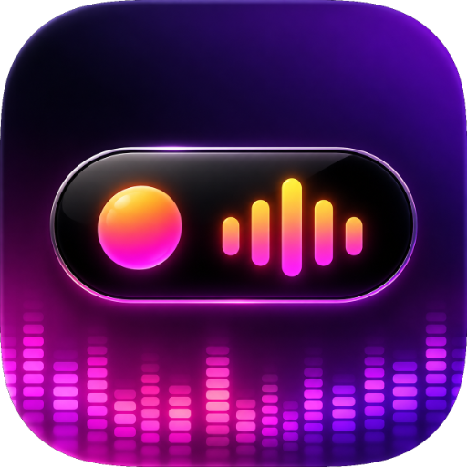
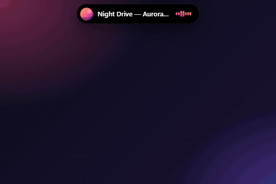
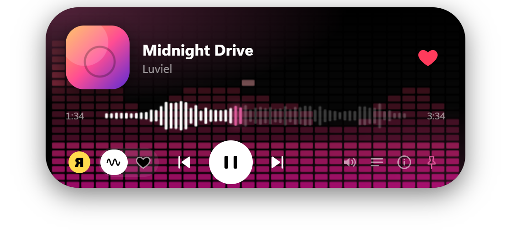
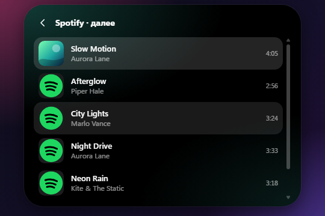
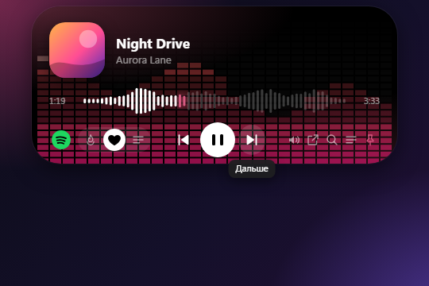

<div align="center">



# Music Island

**Бесплатный музыкальный Dynamic Island для Windows 10/11 с открытым кодом.**
Spotify, Яндекс Музыка, YouTube и SoundCloud в одном плавающем виджете на рабочем столе.

[English](README.md) · **Русский**

[](../../releases/latest)
[](https://luviel19.github.io/Music_Island/ru/)
[](../../releases)


[](../../releases/latest)
[](LICENSE)
[](../../actions/workflows/ci.yml)

<br>



<sub>Демо с выдуманными треками, записано с настоящего интерфейса приложения.</sub>

</div>

<br>

## 💡 Зачем нужен Music Island

Music Island — маленький «остров» в духе Dynamic Island от Apple для рабочего стола Windows. Свёрнутый, он остаётся тонкой таблеткой с живым индикатором. При наведении раскрывается: обложка, название, волновой прогресс и кнопки управления. Цвета подстраиваются под обложку.

- **Несколько сервисов в одном месте:** Spotify, Яндекс Музыка, SoundCloud, YouTube и любой системный плеер.
- **Spotify без ключей разработчика:** внутри острова работает официальный веб-плеер, поэтому подходят и Free, и Premium.
- **Бесплатно и с открытым кодом**, лицензия MIT. В приложении нет рекламы, нет наших аккаунтов и телеметрии.
- **Не мешает:** прозрачные области пропускают клики, остров не уходит за экран и встаёт в самый угол.

**[⬇ Скачать последний релиз](../../releases/latest)** · Windows 10/11 x64 · установщик без цифровой подписи (см. [безопасность](#-безопасность-и-проверка-загрузки)).

<br>

## ✨ Возможности

| | |
|---|---|
| 🏝 **Плавающий остров** | Поверх окон, раскрывается при наведении, перетаскивается, положение можно закрепить, не пропадает по Win+D и при смене мониторов |
| 🔎 **Поиск по сервисам** | Один запрос ищет в Яндекс Музыке, SoundCloud и YouTube; одна песня склеивается в одну строку со значками сервисов |
| 🌊 **Волновой прогресс** | Палочки повторяют форму песни, клик по волне перематывает |
| 🎚 **Эквалайзер на 10 полос** | Яндекс Музыка и SoundCloud: ручная настройка, пресеты, цветная сетка на фоне острова |
| 🧭 **Настройка «Моей волны»** | Яндекс Музыка: подбор по настроению, занятию и характеру песен |
| 📜 **Очередь и карточка трека** | Список следующих треков, подробности, лайки (где их поддерживает сервис) |
| ⌨️ **Медиаклавиши и трей** | Глобальные клавиши, меню в трее, автозапуск вместе с Windows |
| 🔔 **Уведомление об обновлении** | Проверяет GitHub Releases и показывает кнопку «Скачать» (сам ничего не устанавливает) |

<br>

## 🎵 Поддерживаемые сервисы

| Функция | Spotify | Яндекс Музыка | YouTube | SoundCloud | Системный плеер |
|---|:-:|:-:|:-:|:-:|:-:|
| Пауза, следующий, предыдущий, перемотка | ✅ | ✅ | ✅ | ✅ | ✅ |
| Трек, обложка и прогресс в острове | ✅ | ✅ | ✅ | ✅ | ✅ |
| Очередь в острове | ✅ | ✅ | ✅ | ✅ | — |
| Громкость | ✅ | ✅ | ✅ | ✅ | — |
| Лайк | — | ✅ | — | ◐ нужен вход | — |
| Перемешивание | — | ◐ только «Избранное» | — | — | — |
| Эквалайзер на 10 полос | — | ✅ | — | ✅ | — |
| Поиск из острова | ◐ открывает официальную страницу в панели | ✅ | ✅ | ✅ | — |
| Вход | Ваш аккаунт Spotify | OAuth-токен | Не нужен | Необязателен (лайки) | Не нужен |

В таблице только то, что работает в текущем релизе. Недоступная функция скрыта в интерфейсе, а не имитируется.

### 🟢 Spotify подробнее

Spotify подключается **через официальный веб-плеер** `open.spotify.com` в Microsoft Edge WebView2 (вспомогательный процесс `SpotifyHost.exe`, исходники в [`native/spotify-host`](native/spotify-host)).

- Вы входите на настоящей странице Spotify: пароль остаётся только у Spotify, сессия хранится на вашем ПК.
- Остров показывает название, обложку и прогресс, управляет воспроизведением через медиа-команды Windows. Громкость — звуковая сессия плеера в Windows.
- Кнопка **«Моя музыка»** сама включает ваши «Любимые треки» без показа окна. Очередь читается со страницы и показывается в самом острове.
- Библиотека, плейлисты и поиск открываются в панели с официальной страницей под островом.
- Не используются: Spotify Web API, Client ID, ключи разработчика, требование Premium, закрытые API, извлечение cookie, блокировка рекламы, обход DRM и TLS. Реклама в Free играет как в обычном браузере.
- Spotify Desktop и отдельное окно Edge не нужны. WebView2 Runtime входит в современные Windows 10/11.

> [!NOTE]
> Встроенный веб-плеер не отдаёт состояние лайка и перемешивания, поэтому у Spotify в острове нет лайка, перемешивания и эквалайзера. Это ограничения способа, а не недоработки.

<br>

## 🖼 Скриншоты

<p align="center">
  
  
</p>
<p align="center">
  
  
</p>

<br>

## 📥 Установка

1. Скачайте `Music-Island-Setup-*.exe` из **[последнего релиза](../../releases/latest)**.
2. Запустите установщик, выберите папку и дождитесь окончания.
3. Остров появится на экране, а иконка в трее даст доступ к настройкам.

> [!NOTE]
> Установщик **не подписан цифровой подписью**, поэтому Windows SmartScreen может показать «Windows защитила ваш компьютер». Сначала проверьте загрузку (см. ниже), затем нажмите **«Подробнее» → «Выполнить в любом случае»**. Защитник Windows отключать не нужно.

### Вход и настройка

| Сервис | Как подключить |
|---|---|
| **Яндекс Музыка** | Остров сам подскажет, как получить токен, и покажет кнопку вставки. Токен хранится только на вашем ПК в зашифрованном виде |
| **SoundCloud** | Слушать можно без входа. Для лайков вставьте значение cookie `oauth_token` |
| **Spotify** | Выберите «Spotify», нажмите «Подключить аккаунт» и войдите на странице Spotify |
| **YouTube, системный плеер** | Вход не нужен |

### VPN или прокси для SoundCloud и YouTube

Если сервис недоступен в вашей стране, откройте в трее **«VPN/прокси»** и вставьте ссылку из буфера обмена: ссылку на **подписку VPN** (остров перебирает серверы hysteria2 и берёт первый рабочий), ссылку `hysteria2://…` или адрес `socks5://host:port` / `http://host:port`. Через VPN идут **только SoundCloud и YouTube** (вместе с их входом и капчами), остальные сервисы работают напрямую. Ссылка хранится зашифрованной, VPN включается одной галочкой в трее.

<br>

## ❓ Вопросы и ответы

<details>
<summary><b>Music Island бесплатный?</b></summary>

Да. Приложение бесплатное, с открытым кодом под лицензией MIT. В нём нет рекламы и платных функций.
</details>

<details>
<summary><b>Нужен ли Spotify Premium?</b></summary>

Нет. Остров открывает обычный веб-плеер Spotify, поэтому работает Free (с рекламой, как в браузере) и Premium.
</details>

<details>
<summary><b>Почему у Spotify нет лайка и эквалайзера?</b></summary>

Звук играет внутри встроенной страницы Spotify, а состояние лайка и перемешивания она наружу не отдаёт. Остров не показывает функции, которые не может честно выполнить.
</details>

<details>
<summary><b>SoundCloud или YouTube не открываются</b></summary>

Включите VPN или прокси в трее. Остальные сервисы он не затрагивает.
</details>

<details>
<summary><b>Остров мешает кликам по окнам под ним</b></summary>

Не должен: прозрачные области пропускают клики. В свёрнутом виде остров занимает только свою небольшую «таблетку».
</details>

<details>
<summary><b>Связан ли проект со Spotify, Яндексом, YouTube или SoundCloud?</b></summary>

Нет, проект независимый. Все торговые марки принадлежат их владельцам.
</details>

<br>

## 🔒 Безопасность и проверка загрузки

- Установщик **не подписан цифровой подписью**, SmartScreen может предупредить о неизвестном издателе. Скачивайте только из [официальных релизов](../../releases) и сверяйте SHA-256 из описания релиза:

  ```powershell
  Get-FileHash .\Music-Island-Setup-0.2.10.exe -Algorithm SHA256
  ```

- Токены входа (Яндекс Музыка, SoundCloud, ссылка VPN) хранятся зашифрованными средствами Windows (Electron `safeStorage`). Сессия Spotify лежит в профиле WebView2 в `%APPDATA%\Music Island\spotify-profile`.
- Окно острова работает с `contextIsolation`, без Node integration и в песочнице, переходы на другие страницы в нём запрещены. Проверка обновлений только читает тег последнего релиза на GitHub и открывает страницу релиза в браузере.
- Подробности и как сообщить об уязвимости: [SECURITY.md](SECURITY.md).

## ⚠️ Ограничения

- Только Windows 10 и 11.
- Яндекс Музыка и SoundCloud используют неофициальные API: они могут измениться без предупреждения.
- Spotify работает через встроенный веб-плеер. Очередь и «Моя музыка» читаются со страницы Spotify и могут перестать работать, если Spotify изменит вёрстку. Реклама в Free-версии играет как в обычном веб-плеере: остров её не блокирует.
- Звук и VK не поддерживаются: у первого защита от ботов, у второго закрыт API.

<br>

## 🛠 Сборка из исходников

Нужны Windows 10/11 и [Node.js](https://nodejs.org) 20+.

```bash
git clone https://github.com/luviel19/Music_Island.git
cd Music_Island
npm install
npm run build:spotify   # собирает веб-плеер Spotify (нужен только .NET Framework 4.8 из Windows)
npm start
```

Установщик: `npm run dist` создаёт `dist/Music-Island-Setup-*.exe`. Для режима VPN положите `hysteria.exe` в папку `bin/` (в репозиторий он не входит). Тесты: `npm test`. Проверка сайта: `node scripts/check-site.js`.

### Архитектура

Каждая площадка подключается как **провайдер** из двух частей:

```
providers/<id>.js        основной процесс: сеть, токены, доступ к системе
src/providers/<id>.js    интерфейс: воспроизведение, очередь, управление
```

Контракт описан в `src/providers/registry.js`. Возможности площадки перечисляются в `caps`: выключенная функция не показывается, ничего не имитируется. Чтобы площадка участвовала в общем поиске, добавьте `search(host, запрос)`, а для запуска найденного трека `open(host, трек, список)`.

```
.
├── main.js                  окно, трей, настройки, VPN, перетаскивание, границы экрана
├── tunnel.js                запуск hysteria2 для VPN
├── updater.js               проверка новых релизов на GitHub
├── preload.js               мост между окном и основным процессом
├── providers/               провайдеры основного процесса (+ мост SMTC на PowerShell)
├── native/spotify-host/     веб-плеер Spotify на WebView2 (C#, .NET Framework 4.8)
├── src/                     интерфейс острова (app.js, search.js, audio-fx.js, providers/)
├── docs/                    сайт для GitHub Pages (собирается scripts/build-site.js)
├── promo/                   инструменты записи демо и черновики публикаций
├── scripts/                 сборка и проверки сайта
└── tests/                   проверки логики (npm test)
```

<br>

## 🤝 Участие в проекте

Сообщения об ошибках и идеи приветствуются в **[Issues](../../issues)**. Pull Request тоже можно: сначала прочитайте [CONTRIBUTING.md](CONTRIBUTING.md) (запускайте `npm test`, делайте точечные изменения, не добавляйте функции, которые нельзя проверить).

## 👤 Автор

Сделал **[luviel19](https://github.com/luviel19)** · [Лицензия MIT](LICENSE)

## 📜 Дисклеймер

Проект независимый и не связан со Spotify, Яндексом, YouTube, SoundCloud и другими упомянутыми сервисами, а также не одобрен ими. Все торговые марки принадлежат их владельцам. Используйте приложение со своим аккаунтом и в личных целях.
